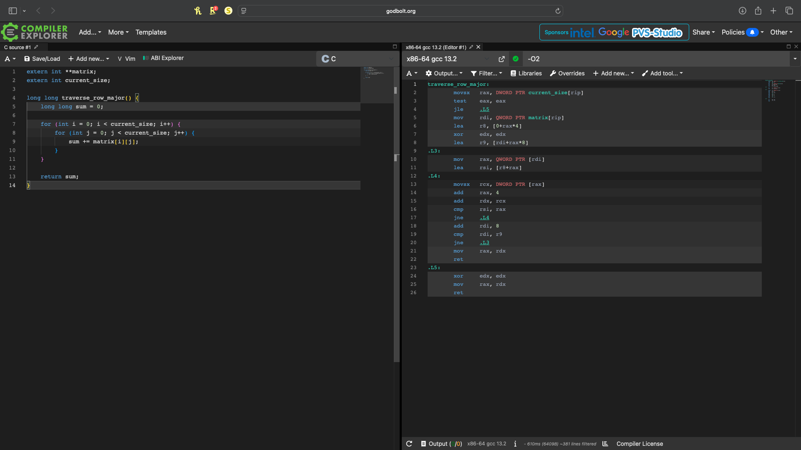
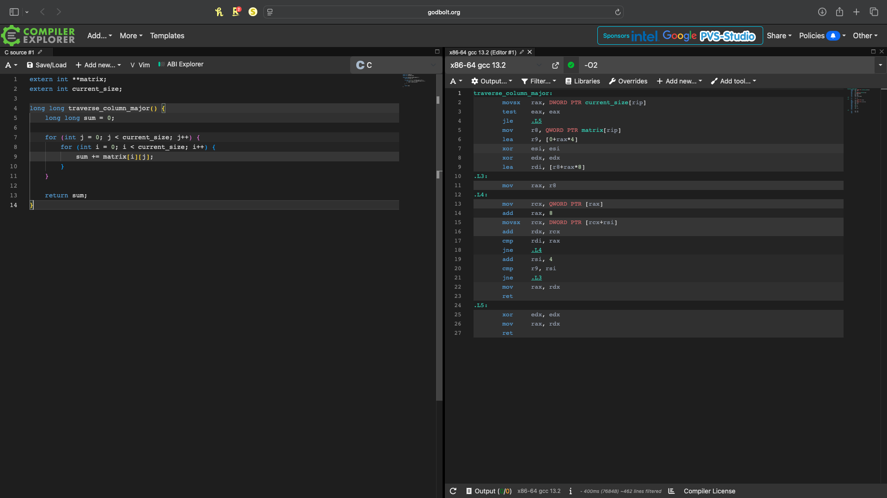

# Cache Behavior Lab Analysis

## Section 1: Performance Measurements

I compiled and ran the program using GCC without specifying an optimization level. I tested row-major and column-major traversal using four different matrix sizes.

| Matrix Size | Row-Major (ms) | Column-Major (ms) | Ratio (Column/Row) |
|---|---:|---:|---:|
| 1000 × 1000 | 2.88 | 4.94 | 1.71x |
| 2000 × 2000 | 6.53 | 22.70 | 3.48x |
| 4000 × 4000 | 13.34 | 94.35 | 7.07x |
| 8000 × 8000 | 66.75 | 145.82 | 2.18x |

The results show that row-major traversal was faster for every matrix size. The largest difference was with the 4000 × 4000 matrix, where column-major traversal took about 7 times longer. This shows that the order in which a program accesses memory can make a big difference in performance, even when both functions perform the same calculation.

## Section 2: Optimization Level Comparison

I compiled and tested the program using three optimization levels: -O0, -O2, and -O3. I wanted to see whether compiler optimizations would improve performance and reduce the difference between row-major and column-major traversal.

| Optimization | Matrix Size | Row-Major (ms) | Column-Major (ms) | Ratio |
|---|---|---:|---:|---:|
| -O0 | 1000 × 1000 | 1.35 | 1.95 | 1.44x |
| -O0 | 2000 × 2000 | 5.46 | 20.08 | 3.67x |
| -O0 | 4000 × 4000 | 16.79 | 97.60 | 5.81x |
| -O0 | 8000 × 8000 | 66.83 | 145.81 | 2.18x |
| -O2 | 1000 × 1000 | 0.08 | 1.39 | 16.52x |
| -O2 | 2000 × 2000 | 0.47 | 7.43 | 15.90x |
| -O2 | 4000 × 4000 | 1.69 | 50.77 | 30.01x |
| -O2 | 8000 × 8000 | 18.53 | 110.48 | 5.96x |
| -O3 | 1000 × 1000 | 0.08 | 1.07 | 12.87x |
| -O3 | 2000 × 2000 | 0.27 | 5.82 | 21.47x |
| -O3 | 4000 × 4000 | 4.00 | 52.64 | 13.15x |
| -O3 | 8000 × 8000 | 19.88 | 104.03 | 5.23x |

### Does -O3 eliminate the performance gap?

No, -O3 does not eliminate the performance gap between the two traversal methods. Although the compiler improves the execution times, column-major traversal is still slower because it accesses memory in a less efficient order. The compiler can optimize instructions, but it does not necessarily change the way the program moves through the matrix.

## Section 3: Assembly Analysis

I used Compiler Explorer with x86-64 GCC 13.2 and the -O2 optimization level to compare the assembly code for both traversal functions.

### Row-Major Assembly

### Column-Major Assembly

### Comparison

The two functions generate similar assembly instructions, including `mov`, `add`, `cmp`, and `jne`. Both use loops to read values from memory and add them together. However, the order in which they access the matrix is different.

In the row-major version, the inner loop moves through consecutive elements within the same row. In the column-major version, the inner loop moves between different rows before moving to the next column.

Even though the assembly instructions are similar, the performance results show a large difference between the two functions. This tells me that the slowdown is not simply caused by the number or type of instructions. It mainly comes from how the CPU accesses memory and how effectively it uses its cache.

## Section 4: Cache Behavior Explanation

In C, two-dimensional arrays are normally stored in row-major order. This means the elements in the first row are stored next to each other in memory, followed by the elements in the second row. When a program reads a matrix row by row, it accesses memory in the same order that the values are stored. This makes row-major traversal more efficient because the CPU can take advantage of how its cache works. Even though both traversal methods perform the same calculation, the order in which they access memory affects how quickly they finish.

The CPU does not usually retrieve just one value from memory at a time. Instead, it loads a block of nearby data called a cache line. A common cache line size is 64 bytes, which can hold 16 integers if each integer uses 4 bytes. During row-major traversal, the CPU loads a cache line and can use several values from it before needing another one. This reduces the number of times the CPU has to wait for data from slower memory. Column-major traversal works differently because it moves from one row to another while staying in the same column. Since those values are farther apart in memory, the CPU may need to load different cache lines more frequently. This can cause more cache misses, especially when the matrix is large.

The compiler can improve performance by reducing unnecessary instructions and making loops more efficient. However, it does not always change the order in which the program accesses the matrix. Changing the loop order can affect the program's behavior in more complicated situations, so the compiler cannot assume that every loop can safely be rearranged. My results showed that even with the -O3 optimization level, column-major traversal was still slower. This helped me understand that writing efficient code is not only about choosing a good algorithm. It is also important to consider how the data is organized and accessed in memory.

### Connection to My Final Project

For my Computer Systems final project, I am working on improving how a program searches through student records. My original version will use a linked list, while my optimized version will use a sorted array with binary search. This assignment helped me understand why storing data close together in memory can improve performance, since arrays generally have better cache locality than linked lists. I will compare the execution times of both versions to see how much the changes improve performance.
